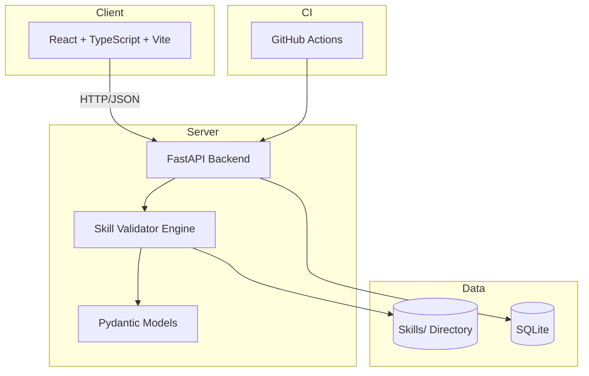

# tensor-lab-144-ryan-vo | Ryan Vo | AI & Machine Learning

> Work in progress. This checkpoint may be incomplete or fail tests. See PLAN.md and STATUS.md before use.


**Offensive Security Skill Validator** — A tool for validating and repairing offensive security skill files (SKILL.md) against the Agent Skills specification.

## Problem

The [Claude-Red](https://github.com/SnailSploit/Claude-Red) library contains 78 offensive security skills, but 28 of them lack proper YAML frontmatter required by the Agent Skills specification. This causes `npx skills add SnailSploit/Claude-Red` to silently install only 50 skills — 36% of the library is missing with no error, only warnings that scroll past.

Additionally, 18 skill descriptions exceed the 1024-character limit, and many payload examples use `attacker.com` (a real, resolvable domain) instead of RFC-reserved placeholders like `attacker.invalid` or `attacker.example`.

## AI/ML Approach

This application implements a **deterministic validation engine** that:

1. **Parses** all SKILL.md files recursively from a Skills directory
2. **Extracts** YAML frontmatter (or legacy `## Metadata` sections)
3. **Validates** against the Agent Skills specification:
   - Required `name` and `description` fields in frontmatter
   - Description length ≤ 1024 characters
   - No `attacker.com` placeholders in payloads
4. **Reports** detailed validation results with per-skill error breakdown
5. **Generates** compliant frontmatter for legacy files (dry-run or apply)

The validation logic is purely deterministic — no LLM required for core functionality. Optional LLM integration can provide human-readable explanations of validation failures.

## Intended User

Security researchers and red team operators who maintain or consume offensive skill libraries for AI-assisted security testing workflows.

## Features

- **Skill Validation** — Scan `Skills/**/SKILL.md` and validate against Agent Skills spec
- **Legacy Migration** — Extract metadata from old `## Metadata` format and generate compliant YAML frontmatter
- **Description Length Check** — Enforce 1024-character limit with exact overage reporting
- **Placeholder Sanitization** — Detect `attacker.com` and recommend RFC-reserved alternatives
- **Web Dashboard** — React + TypeScript UI with filtering, sorting, and real-time validation
- **REST API** — FastAPI backend with `/api/skills/validate`, `/api/skills/list`, `/api/skills/fix` endpoints
- **CI Integration** — GitHub Actions workflow that fails on validation regressions

## Architecture



## Quick Start

### Prerequisites

- Python 3.12+
- Node.js 24+
- Docker (optional)

### Local Development

```bash
# Backend
cd backend
python -m venv .venv
.venv/bin/pip install -r requirements.txt
.venv/bin/python -m uvicorn app.main:app --reload --host 127.0.0.1 --port 8000

# Frontend (separate terminal)
cd frontend
npm install
npm run dev
```

Visit `http://127.0.0.1:5173` — the frontend proxies `/api` to the backend.

### Docker Compose

```bash
docker compose up --build
```

Services:
- Frontend: `http://127.0.0.1:5173`
- Backend API: `http://127.0.0.1:8000`
- Keycloak: `http://127.0.0.1:8080` (admin/admin)

### With Sample Skills Data

The validator expects a `Skills/` directory at the repository root with the Claude-Red structure. To test:

```bash
git clone https://github.com/SnailSploit/Claude-Red.git Skills
# Or copy your own Skills directory
```

Then run the backend and visit the dashboard.

## API Reference

### `GET /health`
Health check endpoint.

**Response:**
```json
{ "status": "ok", "app": "tensor-lab-144-ryan-vo", "version": "1.0.0" }
```

### `GET /api/skills/validate`
Validate all skills.

**Response:** `SkillValidationResult`

### `GET /api/skills/list`
List skills with optional filters.

**Query Parameters:**
- `status` — Filter by validation status
- `category` — Filter by category
- `has_attacker_com` — Filter by attacker.com presence

**Response:** `SkillFile[]`

### `POST /api/skills/fix/{skill_path}`
Generate fixed frontmatter for a skill (dry-run).

**Response:** `SkillFixResult`

### `POST /api/skills/fix-all?apply=false`
Fix all skills missing frontmatter. Set `apply=true` to write changes.

**Response:** `SkillFixResult[]`

## Configuration

Environment variables (`.env`):

| Variable | Description | Default |
|----------|-------------|---------|
| `DATABASE_URL` | SQLite database path | `sqlite+aiosqlite:///./data/app.db` |
| `KEYCLOAK_URL` | Keycloak base URL | — |
| `KEYCLOAK_REALM` | Keycloak realm | — |
| `KEYCLOAK_CLIENT_ID` | OIDC client ID | — |
| `KEYCLOAK_CLIENT_SECRET` | OIDC client secret | — |
| `LLM_PROVIDER` | LLM provider (openai-compatible, anthropic, gemini, ollama) | — |
| `LLM_MODEL` | Model name | — |
| `LLM_BASE_URL` | Custom base URL | — |
| `LLM_API_KEY` | API key (server-side only) | — |
| `SKILLS_DIRECTORY` | Path to Skills directory | `Skills` |

## AI/ML Evaluation

The core validation engine is deterministic and requires no LLM. To evaluate:

```bash
# Run validation on the upstream Claude-Red repo
git clone https://github.com/SnailSploit/Claude-Red.git Skills
cd backend
.venv/bin/python -c "
from app.services.skill_validator import SkillValidator
v = SkillValidator('../Skills')
result = v.validate_all()
print(f'Total: {result.total_files}')
print(f'Valid: {result.valid}')
print(f'Missing frontmatter: {result.missing_frontmatter}')
print(f'Attacker.com: {result.attacker_placeholder}')
print(f'Description > 1024: {result.description_too_long}')
for s in result.skills:
    if s.validation_status != 'valid':
        print(f'  {s.path}: {s.validation_status} - {s.validation_errors}')
"
```

**Expected results on upstream main branch (2026-10-23):**
- Total: 78
- Valid: ~50
- Missing frontmatter: 28
- Attacker.com: ~15 (estimated)
- Description > 1024: 18

**Failure cases:**
- Skills with completely missing `## Description` section cannot be auto-repaired
- Non-UTF-8 encoded files will raise decode errors
- Deeply nested directories beyond `Skills/<category>/<skill>/SKILL.md` may not be categorized correctly

## Security Limitations

- **No authentication in demo mode** — The application runs without OIDC when `KEYCLOAK_URL` is unset. Production deployments MUST configure Keycloak.
- **Localhost binding** — Development servers bind to `127.0.0.1` only. Do not expose directly to untrusted networks.
- **No TLS termination** — Use a reverse proxy (nginx, Caddy, Traefik) with valid certificates for production.
- **LLM API keys** — Only set `LLM_API_KEY` server-side. Never expose in frontend or logs.
- **SQLite** — Single-file database suitable for development. Use PostgreSQL for production multi-user deployments.
- **Skill file writes** — The `fix-all?apply=true` endpoint writes to disk. Ensure proper filesystem permissions and backups.

## Provider Configuration

| Provider | Base URL | Models | Notes |
|----------|----------|--------|-------|
| OpenAI-compatible | `https://api.openai.com/v1` | `gpt-4o`, `gpt-4o-mini` | Includes LiteLLM, OpenRouter, Ollama |
| Anthropic | `https://api.anthropic.com` | `claude-3-5-sonnet`, `claude-3-haiku` | Uses Messages API |
| Gemini | `https://generativelanguage.googleapis.com` | `gemini-1.5-pro`, `gemini-1.5-flash` | Uses generateContent |
| Ollama | `http://localhost:11434/v1` | Any local model | OpenAI-compatible endpoint |

## SSO/SAML Setup

Keycloak supports SAML identity providers via Identity Brokering:

1. Configure Keycloak realm with SAML IdP (Okta, Azure AD, Auth0, etc.)
2. Set `KEYCLOAK_URL`, `KEYCLOAK_REALM`, `KEYCLOAK_CLIENT_ID`, `KEYCLOAK_CLIENT_SECRET` in environment
3. The backend will use OIDC authorization code flow with PKCE

See Keycloak documentation for realm import/export procedures.

## Backup/Restore

```bash
# Backup
docker compose exec backend cp /app/data/app.db /app/data/app.db.backup

# Restore
docker compose exec backend cp /app/data/app.db.backup /app/data/app.db
```

## License

MIT © Ryan Vo <ryandtvo@gmail.com>